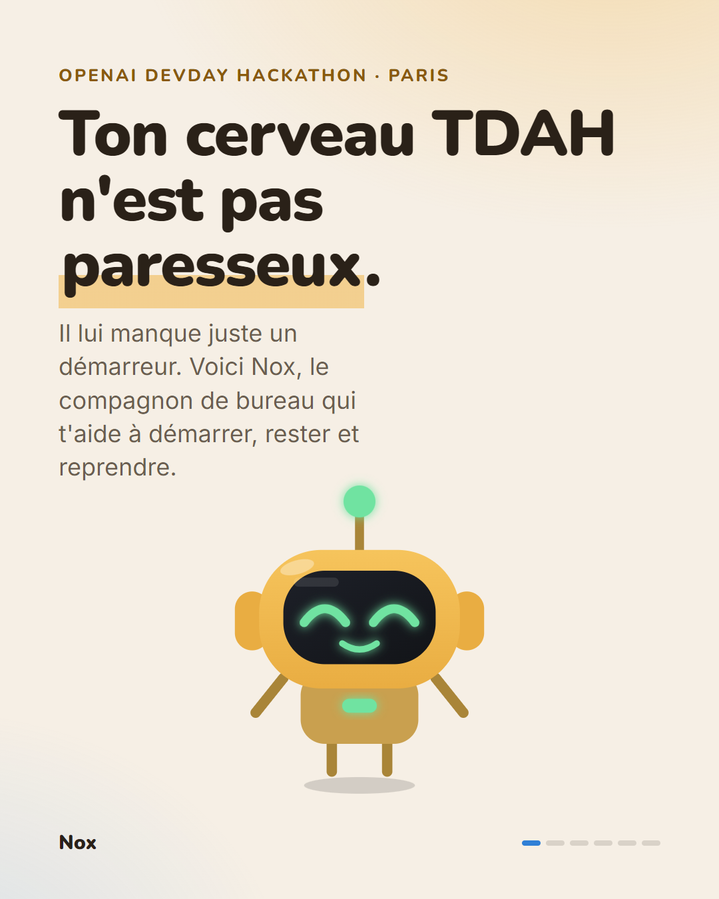
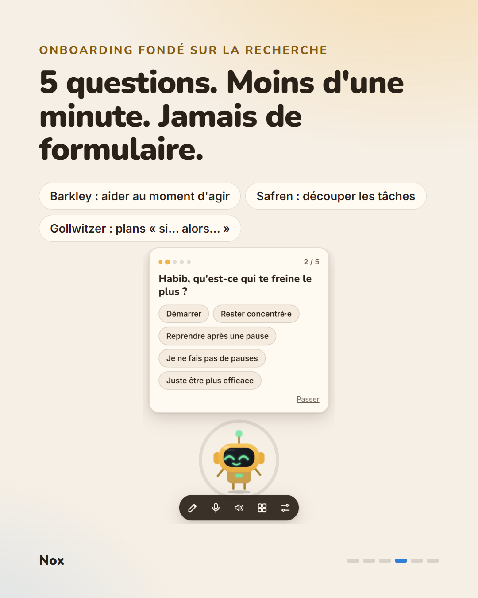
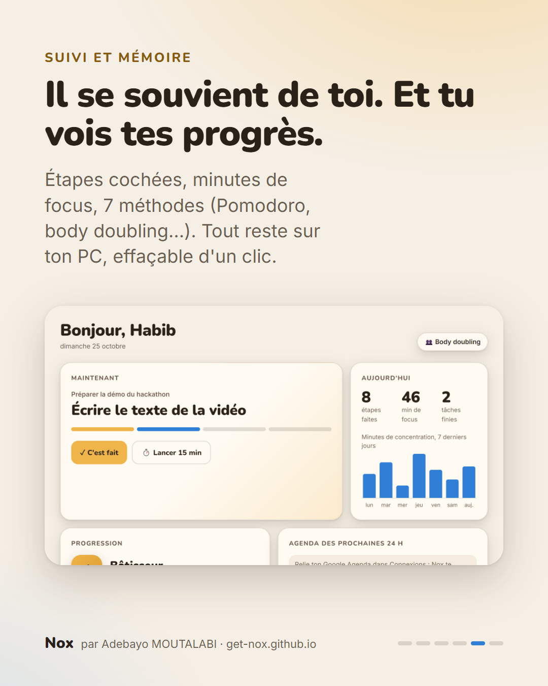

# Nox — un compagnon de bureau pour les cerveaux TDAH

Nox est une petite mascotte qui vit sur ton bureau. Elle **te parle en premier**, découpe ta tâche en **micro-étapes de 2 à 10 minutes**, lance un minuteur visible et t'aide à **démarrer**, **rester concentré·e** et **reprendre** après une interruption. Pensée d'abord pour les personnes TDAH, utile à toute personne qui commence mille choses sans les finir.

Projet réalisé pour l'**OpenAI DevDay Community Hackathon Paris** (piste Impact / inclusion). Propulsé par l'**API Realtime d'OpenAI** (`gpt-realtime-2.1`, voix temps réel en WebRTC) et `gpt-4o-mini`.

<p align="center">
  
  
  
</p>

**Français / English** · **Site de présentation : [get-nox.github.io](https://get-nox.github.io)** · **Télécharger : [dernière version](https://github.com/adebayo-moutalabi/nox/releases/latest)**

## Télécharger (Windows)

1. Va dans **[Releases](../../releases)** et télécharge `Nox.Setup.1.1.0.exe`.
2. Double-clique : Nox s'installe en un clic, se lance, puis démarre avec Windows.
3. L'onboarding te demande ta **clé OpenAI** (elle reste chiffrée sur ton PC) ou te laisse **essayer sans clé** (mode démo, cerveau local).

> Windows peut afficher « Windows a protégé votre ordinateur » : l'installeur n'est pas signé. Clique sur « Informations complémentaires » puis « Exécuter quand même ».

## Ce qu'elle fait

| | |
|---|---|
| **Onboarding parlé** | 5 questions, une à la fois, en moins d'une minute (prénom, ce qui te freine, moment d'énergie, durée de concentration, ton). Réponse au clic, au clavier ou à la voix, toujours « Passer ». |
| **Voix temps réel** | Clic sur la mascotte : on parle librement, on peut lui couper la parole. Repli automatique sur transcription + chat + synthèse. |
| **Mémoire** | Profil, souvenirs appris en parlant, historique des tâches, stats par jour. Tout reste en local, consultable et effaçable. |
| **Tableau de bord** | Étape en cours, étapes cochées, minutes de focus sur 7 jours, progression, agenda, connexions, historique. |
| **Mode jeu** | XP à chaque étape, 8 grades (de Étincelle à Légende), 8 compétences à débloquer. Jamais de série perdue ni de compteur d'échecs. |
| **7 méthodes** | Règle des 5 minutes, Pomodoro, body doubling, Si… alors…, time-boxing, manger la grenouille, règle des 2 minutes. Méthode suggérée selon ton profil. |
| **Google Agenda** | Avec l'adresse secrète iCal : Nox te prévient 60 et 30 min avant un rendez-vous, propose de préparer, et passe ta journée en revue le matin. |
| **Gmail** | Avec un mot de passe d'application : Nox repère les mails importants, propose de te les lire, et te prévient quand un mail attendu arrive (« préviens-moi si la CAF m'écrit »). |
| **Telegram** | Relie ton bot en scannant un QR code : quand tu n'es pas devant ton PC, Nox te prévient sur ton téléphone, et tu peux lui écrire. |
| **Surveillance douce, avec accord** | Décrochage, absence (« tu en étais à… »), hyperfocus. L'accès à la fenêtre active est demandé au lancement de la première tâche. |

Les choix de design s'appuient sur la recherche : [docs/RECHERCHE-TDAH.md](docs/RECHERCHE-TDAH.md).

## Développer

```
npm install
copy .env.example .env
npm start
```

Sans clé : `set NOX_FAKE_AI=1 && npm start` (cerveau de test local, aucun appel à OpenAI).

- `npm test` : lance la vraie appli dans un dossier temporaire et joue tout le parcours (onboarding, tâche, minuteur, permission, mémoire, tableau de bord, mode jeu, agenda, tri des mails, relance). 26 vérifications.
- `npm run dist` : construit l'installeur (`dist/Nox Setup x.y.z.exe`). Le `.env`, les tests et la doc ne sont jamais inclus.
- `node tools/linkedin.js` : régénère les visuels de présentation (données d'exemple).

## Architecture

- `main.js` : fenêtres, appels OpenAI, jeton éphémère pour la voix temps réel, outils, connexions, secrets chiffrés (`safeStorage`), surveillance douce.
- `memory.js` : profil, souvenirs, journal, stats, méthodes, mode jeu (fonctions pures).
- `integrations.js` : lecture iCal, Gmail (IMAP), Telegram (bot + QR code).
- `realtime.js` : client WebRTC de l'API Realtime.
- `renderer.js` + `index.html` + `mascot.js` : mascotte animée, cartes de question, minuteur.
- `dashboard.html` + `dashboard.js` : tableau de bord.
- `design-tokens.css` : charte, polices Nunito et Inter embarquées (licence OFL), mode sombre.

## Limites connues

- Agenda : les événements récurrents ne sont pas encore développés (seule la première occurrence est lue).
- Telegram : chaque utilisateur crée son propre bot ; le PC doit être allumé.
- La clé OpenAI est fournie par l'utilisateur. Un serveur qui la détient est prévu.

## Suite

Assistant pour les démarches administratives (guidage pas à pas, recherche web), Notion et Slack via MCP, version téléphone, extension Chrome, apprentissage des schémas de procrastination.
